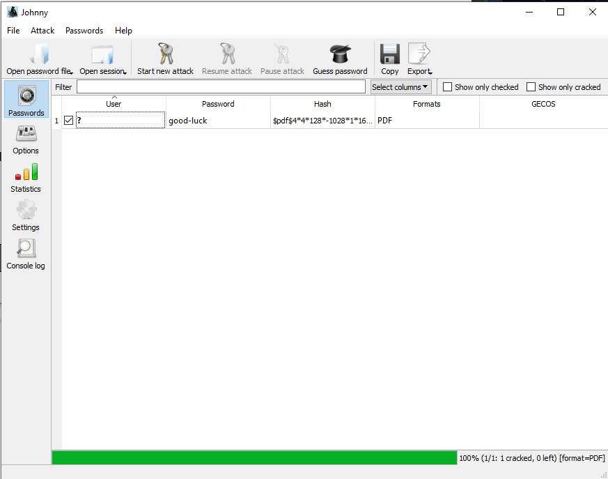

# W3-PM1 — Password Cracking with John the Ripper (JTR)

**Intern:** Taha Chebil | **Batch:** B084 | **Status:** Completed

## Objective

Recover the password of the NetworkWalks training document `My Locked PDF1.pdf` using **John the Ripper (John)** and its graphical interface, **Johnny**, on an authorized lab machine.

## Tools and concepts

- **John the Ripper (JTR):** password-auditing and recovery tool
- **Johnny:** graphical user interface for John the Ripper
- **PDF hash:** password-verification data extracted from a protected PDF
- **Dictionary search:** checks password candidates from a wordlist against a target hash

## Results and evidence

**Result:** Password recovery succeeded in the training exercise. The Johnny screenshot displays a recovered password for the PDF hash; the training PDF displayed completion pages.

### Johnny recovery result

### Completion evidence

## Key lessons

- A protected PDF can contain data that allows offline password candidate verification.
- The strength of the password and the candidate wordlist affect recovery success.
- Johnny provides a graphical way to operate and inspect John the Ripper results.
- Verify results with the training document rather than relying only on a tool message.

