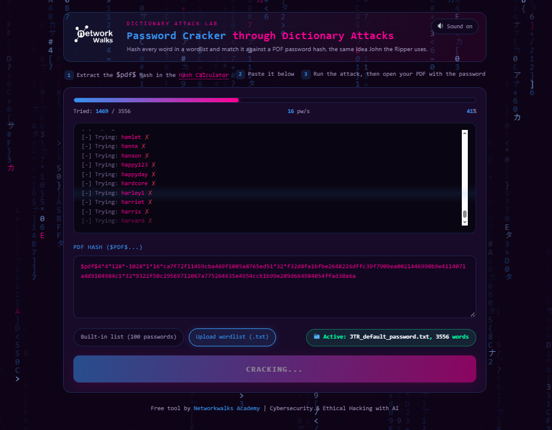

# W3-PM2 — Password Cracking with NetworkWalks Tools

**Intern:** Taha Chebil | **Batch:** B084 | **Status:** Completed

## Objective

Use the NetworkWalks **Hash Calculator** and **Password Cracker** to recover the password for the provided training PDF, then verify that the document opens.

## Tools and concepts

- **NetworkWalks Hash Calculator:** extracts the PDF's password-verification hash
- **NetworkWalks Password Cracker:** tests wordlist candidates against the hash
- **PDF hash format:** `$pdf$...`
- **Dictionary-based recovery:** tests candidates from a predefined list; it is not a guarantee of recovering arbitrary passwords

## Lab workflow

1. Opened the training PDF in the lab environment.
2. Extracted its `$pdf$` hash using the NetworkWalks Hash Calculator.
3. Copied the complete hash into the NetworkWalks Password Cracker.
4. Selected the supplied `JTR_default_password.txt` wordlist (3,556 candidates).
5. Ran the dictionary search and monitored its progress.
6. Observed a successful match and used the recovered password to open the training PDF.
7. Captured the tool result and training completion page.

## Results and evidence

**Result:** Password recovered successfully in the controlled lab. The screenshots show a match at **3,456 / 3,556 candidates (97%)** and the successful recovery screen. The recovered lab password was `good-luck` (not a real-world credential).

### Dictionary search in progress

### Successful result

### Completion evidence

## Key lessons

- Password recovery tests candidate guesses against a verification hash; it does not decrypt a hash back into plaintext.
- Wordlists work when the correct password appears among the candidates.
- Longer, unique passwords or passphrases reduce the effectiveness of common-word dictionary searches.
- Tool output should be verified with the authorized training document.

